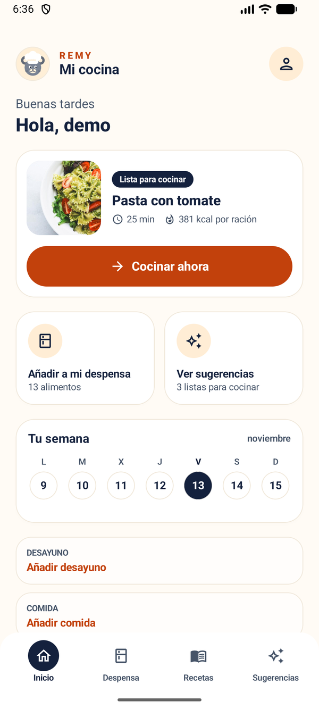
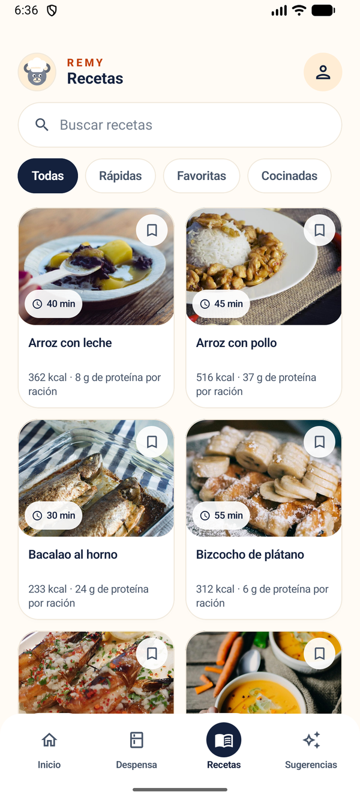
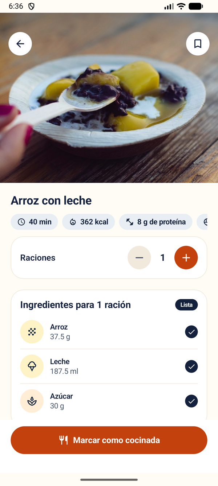
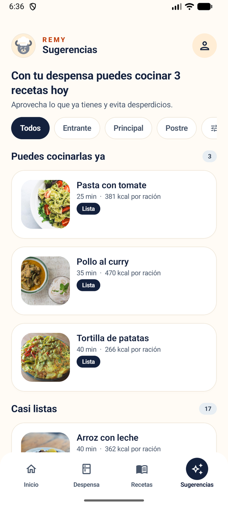
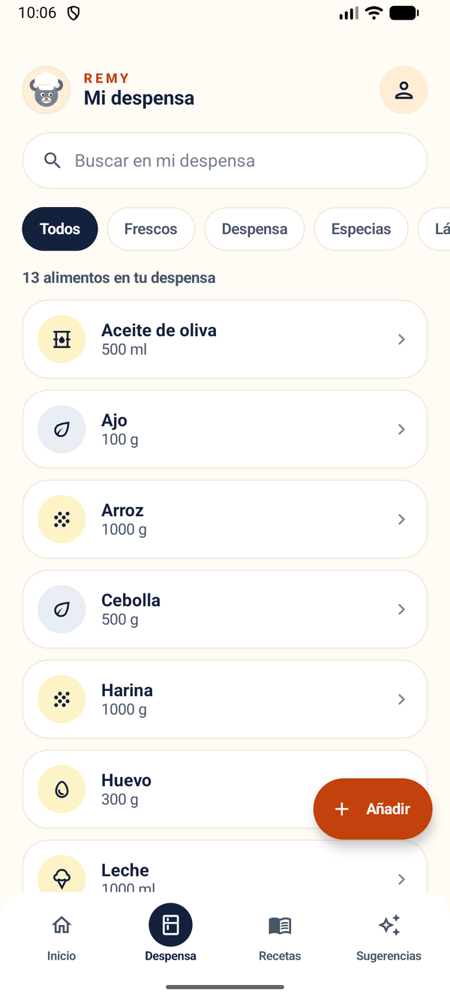
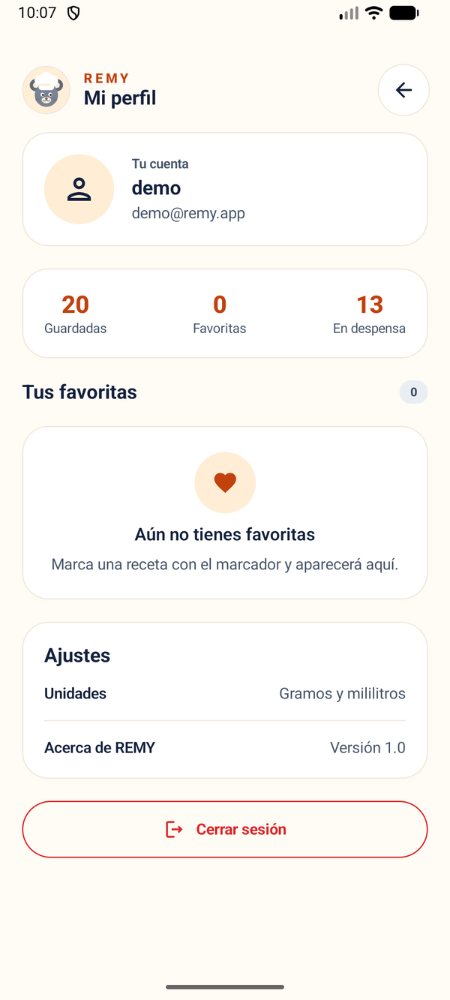

<div align="center">

# 🍳 REMY

**Cocina con lo que ya tienes en casa.**

[](https://developer.android.com)
[](https://kotlinlang.org)
[](https://developer.android.com/jetpack/compose)
[](https://m3.material.io)
[](./LICENSE)

Una app Android que sugiere recetas según los ingredientes de tu despensa, planifica las comidas de la semana y guarda lo que cocinas.

**[Ver capturas](#-capturas)** ·
**[Instalar](#-instalar)** ·
**[Ejecutar desde el código](#-ejecutar-desde-el-código)** ·
**[Documentación](#-documentación)**

</div>

---

## ✨ Características

- **Despensa inteligente:** guarda alimentos con cantidad y unidad; alta, edición y borrado con validación.
- **Sugerencias según lo que tienes:** separa las recetas que puedes cocinar ya de las que les falta poco, e indica los ingredientes que faltan.
- **Catálogo de recetas:** ingredientes, pasos de elaboración y valores nutricionales por ración.
- **Filtros y preferencias:** tipo de plato, tiempo, calorías, proteínas, región, faltantes y macros por ración, con las preferencias guardadas.
- **Planificación semanal:** organiza desayuno, comida y cena por día.
- **Cocinar y guardar:** marca recetas como cocinadas, haz una foto del plato (cámara o galería) y descuenta lo utilizado de la despensa.
- **Cuenta de usuario:** inicio de sesión y registro.

## 📱 Capturas

<div align="center">

| Inicio | Recetas | Detalle |
| --- | --- | --- |
|  |  |  |

| Sugerencias | Despensa | Perfil |
| --- | --- | --- |
|  |  |  |

</div>

## 🚀 Instalar

### APK

```bash
adb install -r entrega/REMY_MARIA_ENTREGA4.apk
```

> Si en tu móvil está activada la instalación de fuentes desconocidas, también puedes copiar el archivo `.apk` y abrirlo desde el explorador de archivos.

### Cuenta de demostración

> La app usa un backend de demostración para el inicio de sesión. Si tu entorno incluye la cuenta de prueba, se indica en la documentación de la entrega.

## 🛠 Ejecutar desde el código

**Requisitos:** Android Studio (reciente), Android SDK y JDK (el JBR que incluye Android Studio sirve). `minSdk` 26.

```bash
git clone https://github.com/mariahts/remy.git
cd remy
```

O abre el proyecto en **Android Studio → File → Open**, espera a la sincronización de Gradle y pulsa **Run**.

Compilación desde terminal:

```bash
# Windows (PowerShell)
$env:JAVA_HOME = "C:\Program Files\Android\Android Studio\jbr"
.\gradlew.bat :app:assembleDebug

# macOS / Linux
./gradlew :app:assembleDebug
```

## 🧠 Tecnologías y arquitectura

| Capa | Tecnologías |
| --- | --- |
| Interfaz | Kotlin, Jetpack Compose, Material 3, Navigation Compose |
| Estado | ViewModel + StateFlow |
| Datos locales | Room (despensa, recetas, plan, historial), DataStore (preferencias) |
| Imágenes / cámara | CameraX, Coil |
| Autenticación | Supabase Auth |
| Tipografía | Nunito (Google Fonts) |

La app sigue una estructura por capas:

```text
app/src/main/java/com/remy/app/
├── data/       # Room, DAOs, repositorios, DataStore, assets del catálogo
├── domain/     # Reglas de negocio (sugerencias, filtros, descuento, color)
├── ui/
│   ├── screens/      # Pantallas Compose
│   ├── components/   # Componentes reutilizables
│   ├── navigation/   # Rutas y barra inferior
│   ├── viewmodel/    # ViewModels y estado
│   └── theme/        # Colores, tipografía y tema
└── MainActivity.kt
```

## ✅ Pruebas

- Pruebas unitarias y instrumentadas (detalle en [`docs/pruebas.md`](docs/pruebas.md)).
- Verificación de compilación y ensamblado (`assembleDebug` / `assembleRelease`).
- Recorrido manual y prueba en dispositivo físico.

## 📚 Documentación

| Documento | Contenido |
| --- | --- |
| [`docs/entrega-4.md`](docs/entrega-4.md) | Entregables y estado de la Entrega 4 |
| [`docs/pruebas.md`](docs/pruebas.md) | Pruebas realizadas, errores y pendientes |
| [`docs/revision-diseno-usabilidad.md`](docs/revision-diseno-usabilidad.md) | Revisión de diseño, usabilidad y accesibilidad |
| [`docs/fotos-recetas.md`](docs/fotos-recetas.md) | Créditos y licencias de las fotos |
| [`docs/evidencias-individuales.md`](docs/evidencias-individuales.md) | Evidencias de contribución |
| [`docs/uso-ia.md`](docs/uso-ia.md) | Registro de uso de IA |

## 🤝 Contribuir

Las contribuciones son bienvenidas: revisa las Issues, abre una rama (`feature/...`, `fix/...`, `docs/...`) y propón los cambios con una Pull Request describiendo qué cambia y cómo se ha probado.

## ⭐ Apoya el proyecto

Si REMY te resulta útil o interesante, deja una estrella ⭐ en el repositorio.

---

<div align="center">

Hecho con 💛 por el equipo REMY.

</div>
