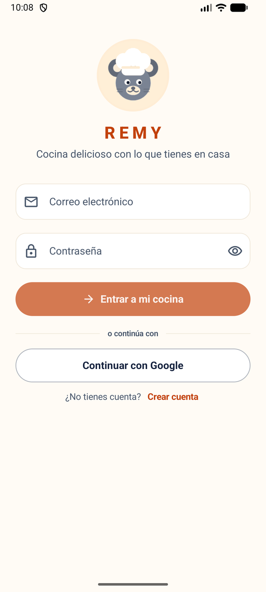

<div align="center">


# REMY

**Cocina con lo que ya tienes en casa.**

Aplicación Android que sugiere recetas según los ingredientes que hay en la despensa,
descuenta lo que se ha cocinado y guarda el histórico con foto.

[Repositorio](https://github.com/mariahts/remy) ·
[Tablero del proyecto](https://github.com/users/mariahts/projects/1) ·
[Índice de la Entrega 4](docs/entrega-4.md) ·
[Créditos de las fotos](docs/fotos-recetas.md)

</div>

---

## Capturas

<table>
<tr>
<td align="center"><br><sub>Inicio</sub></td>
<td align="center"><br><sub>Recetas</sub></td>
<td align="center"><br><sub>Detalle</sub></td>
</tr>
<tr>
<td align="center"><br><sub>Sugerencias</sub></td>
<td align="center"><br><sub>Despensa</sub></td>
<td align="center"><br><sub>Acceso</sub></td>
</tr>
</table>

## Qué resuelve

No saber qué cocinar con lo que ya hay en casa. REMY parte de la despensa real de la
persona usuaria, distingue lo que ya se puede cocinar de lo que «casi» se puede y
descuenta de la despensa lo que se ha cocinado.

Personas usuarias: estudiantes, personas que viven solas o en piso compartido y
familias que cocinan con poco tiempo y presupuesto ajustado.

## Funcionalidades

**Despensa**

- Alta, edición y borrado de alimentos con cantidad y unidad, con validación del
  formulario.
- Los alimentos del catálogo se distinguen de los de la despensa (`enDespensa`), de
  modo que ocultar un alimento no rompe las recetas que lo usan.

**Recetas y sugerencias**

- Catálogo de 20 recetas y 31 alimentos, precargado desde `assets/recetas.json`.
- Sugerencias en dos grupos: «Puedes cocinarlas ya» y «Casi listas», con los
  ingredientes que faltan en cada caso.
- Filtros por tipo de plato, tiempo máximo, calorías máximas, proteínas mínimas,
  región, máximo de faltantes y macros por ración (`Alta en proteína` ≥ 25 g,
  `Baja en hidratos` ≤ 30 g, `Baja en grasa` ≤ 15 g). Se guardan en DataStore,
  sobreviven al cierre de la app y «Limpiar filtros» los restablece.
- Detalle de receta con tiempo, calorías, proteínas, hidratos y grasas **por
  ración**, escaladas con el selector de raciones, y los pasos de elaboración.

**Cocinar**

- Marcar una receta como cocinada: cámara (CameraX) o selector de fotos del
  sistema como alternativa, con el permiso de cámara pedido y el caso de
  denegación contemplado.
- La foto se copia al almacenamiento interno de la app y se recupera al reabrirla.
- Se descuenta de la despensa lo que había, sin bajar nunca de cero, escalado por el
  número de raciones. Si algún ingrediente no se puede descontar, se avisa con su
  nombre y la cocción se guarda igualmente.

**Inicio y planificación**

- Pantalla de inicio con la receta del día, accesos directos, y la semana con el
  plan de comidas por día (desayuno, comida y cena), que se puede añadir o quitar.
- Registro de lo cocinado en el calendario.
- Estados de carga y de error con reintento en las pantallas que consultan la base
  de datos.

**Cuenta**

- Inicio de sesión y registro con Supabase, con validación previa del correo y de
  la contraseña, aviso de que hay que confirmar el correo y opción de reenviarlo.

## Tecnologías

| Tecnología | Para qué |
|---|---|
| Kotlin, Jetpack Compose (Material 3) | Interfaz |
| Navigation Compose | Rutas; barra inferior con cuatro destinos (Inicio, Despensa, Recetas, Sugerencias) |
| Room 2.8.5 | Despensa, recetas, ingredientes, plan de comidas e historial de cocciones. Esquema exportado en `app/schemas/` |
| DataStore 1.1.1 | Preferencias de filtros y versión de la despensa de demostración |
| CameraX 1.6.2 + Coil 2.7.0 | Foto del plato (cámara o galería) y carga de imágenes |
| Supabase (auth) | Inicio de sesión y registro |
| Nunito (Google Fonts) | Tipografía del tema |

## Instalación y ejecución

### Con la APK

`REMY_MARIA_ENTREGA4.apk` es la build de `release` con ofuscación (R8), recorte de
recursos y firma propia (6,7 MB). Se instala en el móvil desde el archivo, o por
ADB:

```bash
adb install -r REMY_MARIA_ENTREGA4.apk
```

Cuenta de demostración: `demo@remy.app` / `Demo1234!`.

### Desde el código

Requiere Android Studio (versión estable reciente) y un emulador Android o un móvil
con depuración USB. `minSdk` 26, `targetSdk` 36.

```bash
git clone https://github.com/mariahts/remy.git
cd remy
./gradlew :app:assembleDebug
```

O en Android Studio: **File → Open** sobre la carpeta `remy`, esperar a la
sincronización de Gradle y pulsar **Run** en el módulo `app`.

Con `JAVA_HOME` apuntando al JBR de Android Studio
(`C:\Program Files\Android\Android Studio\jbr` en Windows) funcionan tanto Gradle
como `apksigner`.

#### Configuración

**No hace falta configurar nada.** La app se conecta a nuestro propio proyecto de
Supabase con la clave publicable incluida en `app/build.gradle.kts`. Esa clave es la
de cliente: está pensada para ir dentro de la aplicación, no es una credencial
secreta (la secreta es la `sb_secret_`, que no aparece en el repositorio). Por eso
cualquiera que clone el proyecto puede compilarlo y usarlo tal cual.

Si alguien quiere apuntarlo a su propio backend, sobreescribe `SUPABASE_URL` y
`SUPABASE_ANON_KEY` en `local.properties` (no se versiona).

La build de release se firma con un almacén de claves propio. Las propiedades
`RELEASE_STORE_FILE`, `RELEASE_STORE_PASSWORD`, `RELEASE_KEY_ALIAS` y
`RELEASE_KEY_PASSWORD` de `local.properties` son opcionales: si no están, la build
sale sin firmar y no falla.

## Recorrido principal para probar

1. La app abre en Inicio. En la primera instalación se precargan el catálogo (20
   recetas y 31 alimentos) y la despensa de la cuenta de demostración.
2. **Despensa**: añadir un alimento con el botón flotante; probar a guardar con
   cantidad 0 para ver el mensaje de validación.
3. **Recetas**: tocar una tarjeta para abrir el detalle (ingredientes, pasos y
   nutrición). Cada receta tiene foto del catálogo.
4. **Sugerencias** (cuarto destino de la barra): con la despensa llena aparecen
   «Puedes cocinarlas ya» y «Casi listas». Al borrar un alimento (por ejemplo
   «Arroz») pasan a «Casi listas» con la lista de lo que falta.
5. En **Sugerencias → filtros**, cambiar un criterio (tipo de plato, tiempo,
   calorías, proteínas, región, faltantes o macros por ración) y comprobar que la
   lista y el contador cambian. Cerrar y abrir la app: los filtros se conservan.
   «Limpiar filtros» los restablece.
6. Abrir una receta y bajar hasta «Marcar como cocinada»: se puede confirmar con
   foto (cámara o galería) o sin ella. La receta queda en el calendario de Inicio y
   la despensa descuenta los ingredientes sin bajar de cero. Si algún ingrediente no
   se puede descontar, la app avisa con su nombre.
7. **Inicio → Tu semana**: tocar otro día del calendario. El contenido se mantiene
   en pantalla y solo cambia el plan del día.
8. **Perfil** (avatar de la cabecera): datos de la cuenta y recetas cocinadas.

## Estructura del proyecto

El código está en `app/src/main/java/com/remy/app/`:

- `data`: entidades, DAO, `RemyDatabase`, repositorios, precarga del catálogo y
  preferencias con DataStore.
- `domain/model`: clases de negocio (`Receta`, `Alimento`).
- `ui`:
  - `screens`: pantallas (inicio, despensa, recetas, sugerencias, perfil, hoja del
    plan, captura de foto y detalle de receta).
  - `components`: componentes reutilizables, entre ellos `RecipePhoto`, que resuelve
    la imagen de una receta (foto de la persona usuaria, foto del catálogo o color
    pastel).
  - `navigation`: rutas y barra inferior.
  - `viewmodel`: ViewModel de cada pantalla.
  - `theme`: `Color.kt`, `Type.kt` y el tema.

Los macros de las recetas no se guardan a mano: `data/MacrosAlimento.kt` los calcula
sumando el aporte de cada ingrediente a partir de la tabla nutricional por 100 g/ml
del catálogo.

## Equipo

- María José Sánchez León ([mariahts](https://github.com/mariahts))
- Mario Jiménez Ruiz ([FedericoCamposMartinez](https://github.com/FedericoCamposMartinez))

Proyecto integrador de PMDM · 2.º DAM · curso 2026–2027.

El trabajo se organiza en el [tablero Kanban](https://github.com/users/mariahts/projects/1)
con las columnas Backlog, Ready, En progreso, En revisión, Hecho y Blocked. Cada issue
lleva en su cuerpo el bloque «Clasificación» con responsable, RA, tamaño, prioridad,
revisor, sprint y dependencias.

### Flujo de trabajo

1. Cada tarea tiene una issue con criterios de aceptación comprobables.
2. Rama propia desde `dev` (`feature/...`, `fix/...`, `docs/...`).
3. Commits pequeños y descriptivos.
4. Pull Request a `dev` con el resumen, las pruebas ejecutadas y `Closes #N`.
5. Revisión de la otra persona, merge en `dev` y la issue pasa a Hecho.

No se hacen commits directos a `main`: la regla de protección de `main` exige una
revisión aprobatoria de alguien con permisos de escritura. El trabajo se integra en
`dev` y `main` se actualiza al cerrar cada hito.

## Estado actual (12 de noviembre de 2026)

- **Base de datos**: Room en la versión 8, con migraciones explícitas y esquema
  exportado en `app/schemas/`. Cada migración tiene su prueba instrumentada.
- **Catálogo**: 20 recetas y 31 alimentos. Las kcal, proteínas, hidratos y grasas de
  cada receta se calculan a partir de los ingredientes al precargar
  (`macrosDeReceta`), de modo que el catálogo y la app no pueden desincronizarse.
  Los pasos van de cuatro a cinco por receta. La proteína del yogur natural está
  corregida (3 g/100 g, no 10).
- **Fotos**: las 20 recetas tienen una fotografía real del plato con licencia libre;
  el autor, la licencia y el enlace de cada una están en `docs/fotos-recetas.md`. Si
  falta la foto, la miniatura usa un color pastel. La foto que hace la persona
  usuaria al cocinar tiene prioridad sobre la del catálogo.
- **Interfaz**: tema crema/terracota/azul tinta con Nunito, cuatro destinos en la
  barra inferior, estados vacíos propios, insignia de disponibilidad en la receta del
  día y los dos accesos directos de Inicio con la misma altura. La revisión de
  diseño, usabilidad y accesibilidad está en
  [`docs/revision-diseno-usabilidad.md`](docs/revision-diseno-usabilidad.md).
- **Filtros**: seis criterios más tres de macros por ración, persistidos en DataStore.
- **Cocción**: foto con CameraX o galería, descuento de despensa por raciones y aviso
  de los ingredientes que no se pueden descontar.
- **Pruebas**: 54 unitarias (10 suites) y 22 instrumentadas (7 suites), todas en
  verde. El detalle está en [`docs/pruebas.md`](docs/pruebas.md).
- **APK de entrega**: `release` con ofuscación R8, recorte de recursos y firma propia,
  de **6,7 MB** (7.051.273 bytes).

### Pendiente

- Memoria en Word (#41) y presentación de la defensa (#42), fuera del repo.
- Pruebas con 2-3 personas ajenas al equipo, sin explicación previa.
- Comprobar letra grande y gama baja en un móvil real: la app ya se ha probado en
  un dispositivo físico y funciona, pero no se ha verificado con la fuente ampliada
  ni en un equipo de gama baja.
- Contraste de los macros del catálogo con una fuente de referencia (la tabla usada
  es estándar, pero está revisada a mano, no por una base de datos oficial).
- Caducidad de los alimentos de la despensa: el modelo actual no tiene ese campo y
  añadirlo supondría una migración de la base de datos.
- Modo oscuro: el diseño solo define el modo claro.
- Publicación en tienda: icono definitivo, capturas y política de privacidad.

## Documentación

| Documento | Contenido |
|---|---|
| [`docs/entrega-4.md`](docs/entrega-4.md) | Los ocho entregables de la Entrega 4 y su estado |
| [`docs/leeme-entrega4.md`](docs/leeme-entrega4.md) | El leeme del ZIP que se entrega al profesor |
| [`docs/pruebas.md`](docs/pruebas.md) | Qué se ha probado, con qué resultado y qué queda pendiente |
| [`docs/revision-diseno-usabilidad.md`](docs/revision-diseno-usabilidad.md) | Revisión de diseño, usabilidad y accesibilidad |
| [`docs/evidencias-individuales.md`](docs/evidencias-individuales.md) | Evidencias de contribución de cada integrante |
| [`docs/uso-ia.md`](docs/uso-ia.md) | Registro del uso de IA: para qué, qué se cambió y cómo se verificó |
| [`docs/fotos-recetas.md`](docs/fotos-recetas.md) | Crédito de las fotos del catálogo |
| [`docs/plantilla-recetas.md`](docs/plantilla-recetas.md) | Prompt para añadir o cambiar recetas del catálogo, con la tabla de alimentos |
| [`docs/mvp-estado.md`](docs/mvp-estado.md) | Estado del MVP, resuelto y pendiente |
| [`docs/ModeloE_R_Remy.drawio`](docs/ModeloE_R_Remy.drawio) | Modelo de datos |
| [`docs/disenio/`](docs/diseno) | Maqueta de la interfaz, identidad visual y material de diseño |

La memoria del proyecto se entrega en Word en el Aula Virtual.
