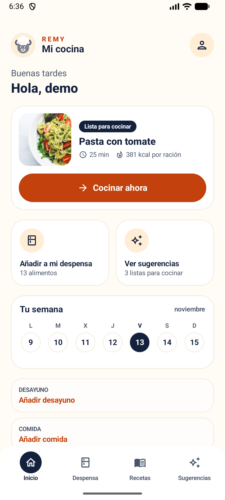
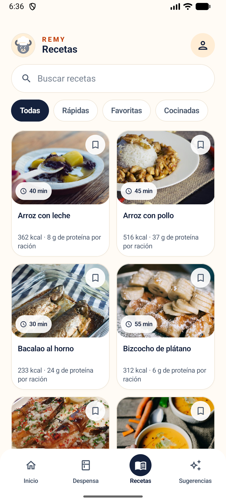
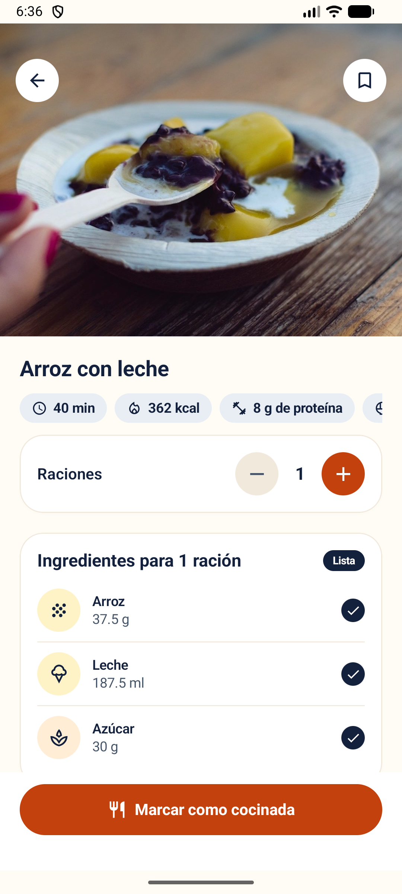
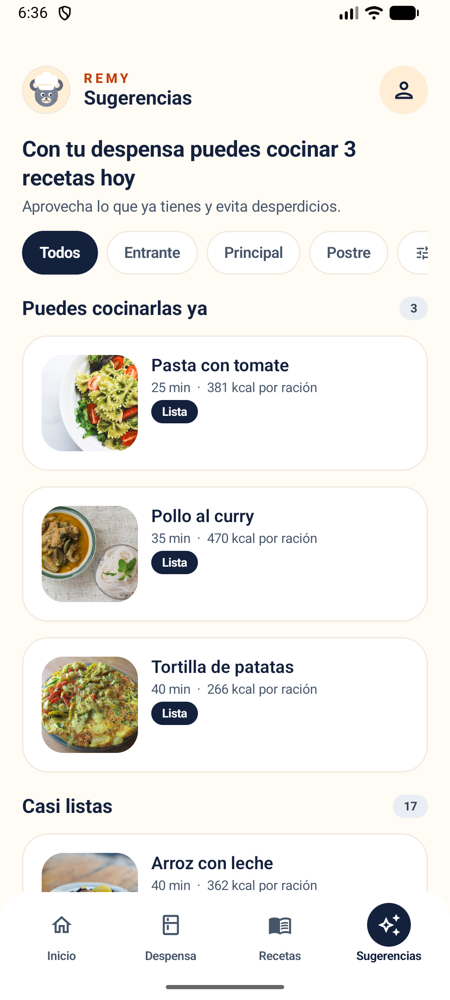
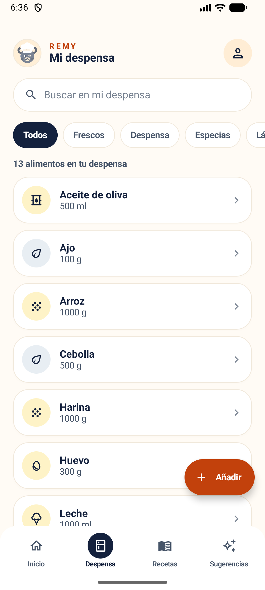
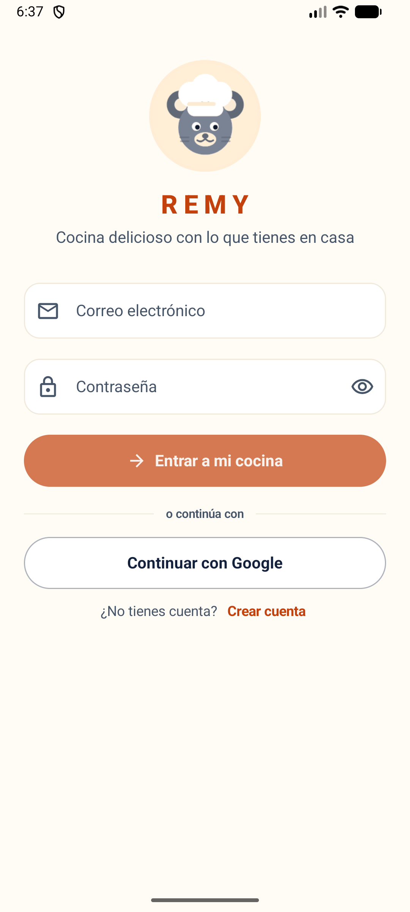

  

<h1 align="center">REMY — Entrega 4</h1>

<strong>Cocina con lo que ya tienes en casa.</strong>

Versión candidata de la aplicación Android REMY, con la funcionalidad principal integrada, las pruebas ejecutadas y la documentación al día.

---

**María José Sánchez León** ([mariahts](https://github.com/mariahts)) ·
**Mario Jiménez Ruiz** ([FedericoCamposMartinez](https://github.com/FedericoCamposMartinez))

- **Repositorio:** https://github.com/mariahts/remy
- **Tablero Kanban:** https://github.com/users/mariahts/projects/1
- **Fecha de cierre de la entrega:** domingo 15 de noviembre de 2026, 23:59

## Las pantallas de la versión de entrega

<table>
<tr>
<td align="center"> Inicio</td>
<td align="center"> Recetas</td>
<td align="center"> Detalle</td>
</tr>
<tr>
<td align="center"> Sugerencias</td>
<td align="center"> Despensa</td>
<td align="center"> Acceso</td>
</tr>
</table>

## Qué contiene este ZIP

| | |
|---|---|
| `REMY_MARIA_ENTREGA4.apk` | Versión candidata: build de `release` con ofuscación R8, recorte de recursos y firma propia. 7.073.133 bytes (6,7 MB). |
| `LEEME.md` | Este documento: qué se entrega, cómo instalarlo, qué se ha probado y qué queda pendiente. |
| `README.md` | El README del repositorio: descripción de la app, cómo compilar y ejecutarla, recorrido principal y estado actual. |
| `capturas-pantallas/` | Las siete pantallas de la versión de entrega, a resolución completa. |
| `docs/` | La documentación que acompaña a la entrega (ver la tabla de más abajo). |
| `logo-remy.png` | Logotipo de la aplicación. |

## Cómo instalar y probar

La APK está firmada con una clave propia, así que el sistema pedirá permiso para
instalarla desde orígenes desconocidos.

1. Copiar `REMY_MARIA_ENTREGA4.apk` al móvil o al emulador.
2. Instalarla (o, con el SDK de Android en el PATH: `adb install -r REMY_MARIA_ENTREGA4.apk`).
3. Entrar con la cuenta de demostración: `demo@remy.app` / `Demo1234!`.

El login es el único punto que usa un servicio externo (el proyecto de Supabase del
equipo); el resto de la app funciona sin conexión. **No hay que configurar nada**:
la URL y la clave publicable de cliente van por defecto en el código, así que el
repositorio se compila y se usa tal cual.

## Los ocho entregables

| # | Entregable | Dónde | Estado |
|---|---|---|---|
| 1 | Enlaces al repositorio y al GitHub Project | Este documento y `README.md` | Completado |
| 2 | Versión candidata con la funcionalidad principal integrada | `REMY_MARIA_ENTREGA4.apk` (6,7 MB) | Completado |
| 3 | Lista de pruebas realizadas y sus resultados | `docs/pruebas.md` y la sección de pruebas de este documento | Completado |
| 4 | Revisión del diseño, la usabilidad y la accesibilidad | `docs/revision-diseno-usabilidad.md` | Completado |
| 5 | Memoria en Word y README.md actualizados | `README.md` (la memoria se entrega en Word en el Aula Virtual) | Completado |
| 6 | Tablero Kanban revisado | Project 1 y `docs/entrega-4.md` | Completado |
| 7 | Evidencias individuales de cada integrante | `docs/evidencias-individuales.md` | Completado |
| 8 | Resumen de qué se terminó o corrigió antes de la entrega definitiva | Sección final de este documento | Completado |

## Documentos incluidos

| Documento | Para qué |
|---|---|
| `docs/entrega-4.md` | Los ocho entregables de la Entrega 4 y su estado |
| `docs/pruebas.md` | Qué se ha probado, con qué resultado y qué queda pendiente |
| `docs/revision-diseno-usabilidad.md` | Revisión de diseño, usabilidad y accesibilidad |
| `docs/evidencias-individuales.md` | Evidencias de contribución de cada integrante |
| `docs/uso-ia.md` | Registro del uso de IA: para qué, qué se cambió y cómo se verificó |
| `docs/plantilla-recetas.md` | Prompt para añadir o corregir recetas del catálogo, con la tabla de alimentos |
| `docs/fotos-recetas.md` | Crédito de las fotos del catálogo |
| `docs/mvp-estado.md` | Estado del MVP, resuelto y pendiente |

## Pruebas

| Tipo | Resultado |
|---|---|
| Unitarias (`testDebugUnitTest`) | **54 en verde**, en 10 suites |
| Instrumentadas (`connectedDebugAndroidTest`) | **22 en verde**, en 7 suites, en el emulador `Medium_Phone_API_37.0` (Android 17) |
| Compilación | `./gradlew :app:testDebugUnitTest :app:assembleDebug` y `./gradlew :app:assembleRelease`: BUILD SUCCESSFUL |

La aplicación se ha instalado y probado también en un **móvil físico**, y funciona.
Detalle de qué comprueba cada prueba en `docs/pruebas.md`.

## Seguridad de los datos

La app guarda la despensa, las recetas y el plan **en el propio dispositivo**, en una
base de datos local de Room. De Supabase solo se usa el servicio de autenticación, y
no se expone ninguna tabla. La auditoría hecha con la clave publicable (la única que
va dentro de la app) da:

| Comprobación | Resultado |
|---|---|
| API de administración de usuarios | `401` — no se puede listar ni tocar cuentas |
| Listado de tablas del backend | `401` — solo las claves secretas ven el esquema |
| Lectura de cualquier tabla | `404` — no hay tablas accesibles con la clave de cliente |
| Inserción en cualquier tabla | `404` — no hay superficie de escritura |
| Funciones RPC expuestas | ninguna |
| Sesión sin iniciar | `401` — no se devuelven datos de ninguna cuenta |

Además, el alta de cuenta **exige confirmar el correo**, así que un registro no da
acceso a nada hasta que se confirma; y las peticiones de alta están limitadas por el
propio Supabase, lo que frena el abuso de la clave pública.

En el repositorio no hay ninguna clave secreta: `local.properties` (donde viven las
contraseñas de la firma de release) está en `.gitignore` y no aparece en ninguno de
los 244 commits.

## Errores encontrados y cómo se han resuelto

| Error | Cómo se ha resuelto |
|---|---|
| El botón «Añadir» de la hoja del plan se recortaba y se leía «Añadi». | El componente `OutlineButton` acepta ahora el relleno horizontal y el ancho que necesita. |
| El título decía «Añadir a el desayuno». | Plantilla «Añadir %1$s» y cadenas «al desayuno», «a la comida», «a la cena». |
| El enlace «Crear cuenta» no hacía nada con los campos vacíos. | Ahora es pulsable siempre y muestra el error de validación. |
| Al registrarse, la app parecía no hacer nada. | Supabase exige confirmar el correo: ahora se explica el paso, se ofrece reenviarlo y, si la cuenta ya existía, se entra directamente. |
| El reenvío del correo a veces fallaba. | Era el límite de Supabase (`HTTP 429`), no la app: ahora se explica. |
| Al tocar otro día del calendario, la pantalla parpadeaba y perdía el scroll. | El estado «Cargando» ya no se emite en cada cambio de día; se mantiene el contenido anterior. |
| Los macros no coincidían con los calculados desde los ingredientes. | Se leían decimales como enteros: ahora se leen con precisión decimal y se redondea igual que en Kotlin. |
| La suite de filtros no compilaba y `PrecargaRecetasTest` miraba la lista equivocada. | Ambas corregidas; las 22 instrumentadas se ejecutan de verdad. |
| La despensa de demostración sembraba «Pasta», un alimento que no existía, y con unidades que no quadraban con las recetas. | Catálogo con 31 alimentos y unidades reales: hay recetas listas desde el primer momento. |
| Los macros y las recetas del catálogo estaban estimados a ojo. | Los macros se calculan a partir de la tabla nutricional de cada ingrediente y hay una prueba instrumentada que lo comprueba. |

## Qué queda pendiente

- Memoria en Word y presentación de la defensa.
- Comprobar la fuente de letra ampliada y un equipo de gama baja: la app ya se ha
  probado en un móvil físico y funciona, pero no en esas dos condiciones.
- Prueba con 2-3 personas ajenas al equipo, sin explicación previa.
- Contraste de los macros con una fuente de referencia oficial.
- Caducidad de los alimentos de la despensa (requiere migración de la base de datos)
  y modo oscuro (el diseño solo define el modo claro).
- Publicación en tienda: icono definitivo, capturas y política de privacidad.
